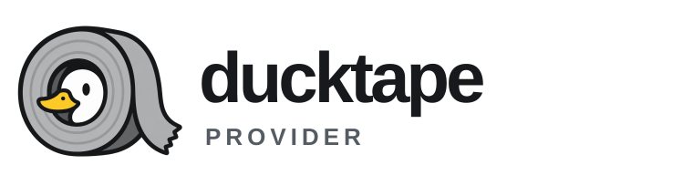

<p align="center">
  <picture>
    <source media="(prefers-color-scheme: dark)" srcset="assets/ducktape-lockup-dark.svg">
    
  </picture>
</p>

One normalized interface over model vendors, one implementation, several languages.

Status: in development, not released. The interface is frozen in [`docs/ducktape-provider-vault/Interface spec.md`](docs/ducktape-provider-vault/Interface%20spec.md); the JSON contract is in [`schema/`](schema).

## Layout

| Path | |
|---|---|
| `schema/provider.schema.json` | Normalized types: messages, blocks, tools, options, responses, events, errors, config |
| `schema/effects.schema.json` | Core-to-host protocol: `Start`, `Resume`, `Step` |
| `crates/core` | Sans-I/O core: types, codecs, effects state machine |
| `crates/abi` | `extern "C"` surface, built natively and as `core.wasm` |
| `crates/conformance` | Fixture runner |
| `crates/py` | PyO3 module behind the Python package |
| `bindings/python` | Python package: `Provider`, `AsyncProvider`, messages, errors |
| `bindings/js` | npm package on `core.wasm`: `Provider`, streams, messages, errors, `index.d.ts` |
| `bindings/go` | Go module on `core.wasm` through wazero: `Provider`, streams, messages, errors |
| `fixtures/` | Samples every binding must pass |

## Python

Not on PyPI yet. Build it in place with [maturin](https://www.maturin.rs):

```
cd bindings/python && uv venv && uv pip install httpx pytest && uvx maturin develop --uv
```

```python
from ducktape_provider import Provider, user, assistant, tool, tool_result, ToolDef

p = Provider("anthropic", default_model="claude-opus-5-5")        # key from ANTHROPIC_API_KEY
r = p.chat([user("hello")])
print(r.text, r.usage, r.stop.reason)

for ev in p.stream([user("tell me a story")]):
    if ev.type == "text_delta":
        print(ev.text, end="")

add = ToolDef("add", "Adds two numbers", {"type": "object", "properties": {"a": {"type": "number"}, "b": {"type": "number"}}})
history = [user("what is 2+2?")]
r = p.chat(history, tools=[add])
if r.stop.reason == "tool_call":
    call = r.tool_calls[0]
    history += [assistant(r), tool(tool_result(call.id, "4"))]
    r = p.chat(history, tools=[add])
```

| Need | Write |
|---|---|
| Another host, same wire | `Provider("openai", base_url="https://api.groq.com/openai", auth=env("GROQ_API_KEY"))` |
| A key in code | `Provider("anthropic", auth="sk-ant-...")` |
| A token fetched at request time | `Provider("openai", auth=resolver(get_token))` |
| An existing login | `Provider("openai", auth=session("codex"))`, `Provider("anthropic", auth=session("claude_code"))`, `session("anthropic_profile", profile="work")` |
| Refreshing another tool's login | `session("codex", refresh="memory")` keeps the new token in process; `refresh="write_back"` updates the tool's store |
| Login state | `p.auth_status()` gives `source`, `expires_at` and `session`; `source` is `None` when nothing is configured |
| Several sources in order | `Provider("anthropic", auth=[session("claude_code"), env("ANTHROPIC_API_KEY")])` |
| Your own keychain reader | `Provider("openai", auth=session("codex"), keychain=lambda service, account: keyring.get_password(service, account))`; the default reads macOS Keychain, Linux Secret Service and Windows Credential Manager |
| Local Ollama | `Provider("ollama", default_model="llama3")` |
| Options | `p.chat(msgs, options={"max_output_tokens": 500, "reasoning": "high", "tool_choice": {"name": "add"}})` |
| Vendor fields | `p.chat(msgs, vendor={"anthropic": {"temperature": 0.2}})` |
| Images | `user("what is this?", image(png_bytes))` or `image(url="https://...")` |
| Embeddings | `Provider("openai", default_embedding_model="text-embedding-3-small").embed(["a", "b"]).embeddings` |
| Discovery | `p.models()`, `p.model_info("gpt-5")`, `p.capabilities("gpt-5")` |
| asyncio | `AsyncProvider` has the same methods as coroutines; `stream()` is an async iterator |
| Your own `httpx` client | `Provider("openai", client=httpx.Client(proxy=...))` |

Every error is a `ProviderError` with `kind`, `status`, `code`, `retryable`, `retry_after`, `attempts`, `body`, `request_id` and `origin`. Subclasses by kind: `AuthError`, `RateLimitError`, `QuotaError`, `ServerError`, `NetworkError`, `TimeoutError`, `CancelledError`, `NotFoundError`, `ContextOverflowError`, `RequestTooLargeError`, `BadRequestError`, `MalformedResponseError`, `UnsupportedError`. Argument mistakes raise `ValueError` or `TypeError` before any request.

Types are dataclasses in [`bindings/python/src/ducktape_provider/_types.py`](bindings/python/src/ducktape_provider/_types.py); the JSON contract behind them is [`schema/provider.schema.json`](schema/provider.schema.json).

## JavaScript

Not on npm yet. Build the wasm core into the package, then import it from `bindings/js`:

```
cd bindings/js && npm run build:wasm && npm test
```

```js
import { Provider, user, assistant, tool, toolResult } from "ducktape-provider";

const p = new Provider("openai", { default_model: "gpt-5" });            // key from OPENAI_API_KEY
const r = await p.chat([user("hello")]);
console.log(r.text, r.usage, r.stop.reason);

for await (const ev of p.stream([user("tell me a story")])) {
  if (ev.type === "text_delta") process.stdout.write(ev.text);
}

const add = { type: "function", name: "add", description: "Adds two numbers", input_schema: { type: "object", properties: { a: { type: "number" }, b: { type: "number" } } } };
let history = [user("what is 2+2?")];
let reply = await p.chat(history, { tools: [add] });
if (reply.stop.reason === "tool_call") {
  const call = reply.toolCalls[0];
  history = [...history, assistant(reply), tool(toolResult(call.id, "4"))];
  reply = await p.chat(history, { tools: [add] });
}
```

| Need | Write |
|---|---|
| Another host, same wire | `new Provider("openai", { base_url: "https://api.groq.com/openai", auth: env("GROQ_API_KEY") })` |
| A key in code | `new Provider("anthropic", { auth: "sk-ant-..." })` |
| A token fetched at request time | `new Provider("openai", { auth: resolver(getToken) })` |
| An existing login | `new Provider("openai", { auth: session("codex") })`, `session("anthropic_profile", { profile: "work" })` |
| Refreshing another tool's login | `session("codex", { refresh: "memory" })` or `{ refresh: "write_back" }`, same meaning as in Python |
| Login state | `await p.authStatus()` gives `source`, `expires_at` and `session` |
| Your own keychain reader | `new Provider("openai", { auth: session("codex"), keychain: async (service, account) => ... })`; the default reads macOS Keychain, Linux Secret Service and Windows Credential Manager |
| In a browser | `resolver()` against your backend; an API key needs `dangerously_allow_browser: true` |
| Cancel | `signal: controller.signal` on any call, or `stream.cancel()` |
| Options and vendor fields | same keys as Python: `{ options: { reasoning: "high" }, vendor: { openai: { temperature: 0.2 } } }` |
| Images | `user("what is this?", image(pngBytes))` or `image(null, { url: "https://..." })` |
| Your own transport | `new Provider("openai", { fetch: myFetch })` |
| Your own `core.wasm` location | `new Provider("openai", { core: new URL("/static/core.wasm", location.href) })` |

Data fields use the schema's names (`default_model`, `tool_call_id`); methods and views are camelCase (`modelInfo`, `toolCalls`). Errors are the same classes as in Python, with `kind` as the stable discriminator. Types: [`bindings/js/index.d.ts`](bindings/js/index.d.ts) for the API and [`bindings/js/schema.d.ts`](bindings/js/schema.d.ts), generated from the JSON schema, for the data.

## Go

Not tagged yet. Build the wasm core into the module, then use it from `bindings/go` (a `replace` directive or a workspace):

```
cargo build --profile wasm --target wasm32-unknown-unknown -p ducktape-abi && cp target/wasm32-unknown-unknown/wasm/ducktape_abi.wasm bindings/go/core.wasm
```

```go
import ducktape "github.com/adrian729/ducktape-provider/bindings/go"

p, err := ducktape.New("anthropic", ducktape.Config{DefaultModel: "claude-opus-5-5"})   // key from ANTHROPIC_API_KEY
r, err := p.Chat(ctx, []ducktape.Message{ducktape.UserText("hello")}, nil)
fmt.Println(r.Text(), r.Usage, r.Stop.Reason)

s, err := p.Stream(ctx, []ducktape.Message{ducktape.UserText("tell me a story")}, nil)
for s.Next() {
	if ev := s.Event(); ev.Type == "text_delta" {
		fmt.Print(ev.Text)
	}
}
err = s.Err()

add := ducktape.FunctionTool("add", "Adds two numbers", map[string]any{"type": "object", "properties": map[string]any{"a": map[string]any{"type": "number"}, "b": map[string]any{"type": "number"}}})
history := []ducktape.Message{ducktape.UserText("what is 2+2?")}
r, err = p.Chat(ctx, history, &ducktape.ChatOptions{Tools: []ducktape.Tool{add}})
if r.Stop.Reason == ducktape.StopReasonToolCall {
	call := r.ToolCalls()[0]
	history = append(history, ducktape.AssistantFrom(r), ducktape.ToolMessage(ducktape.ToolResultText(call.ID, "4")))
	r, err = p.Chat(ctx, history, &ducktape.ChatOptions{Tools: []ducktape.Tool{add}})
}
```

| Need | Write |
|---|---|
| Another host, same wire | `ducktape.New("openai", ducktape.Config{BaseURL: "https://api.groq.com/openai", Auth: []ducktape.Credential{ducktape.Env("GROQ_API_KEY")}})` |
| A key in code | `Auth: []ducktape.Credential{ducktape.Key("sk-ant-...")}` |
| A token fetched at request time | `Auth: []ducktape.Credential{ducktape.Resolver(func(ctx context.Context) (string, error) { ... })}` |
| An existing login | `ducktape.Session("codex")`, `ducktape.Session("anthropic_profile", ducktape.SessionOptions{Profile: "work"})` |
| Refreshing another tool's login | `ducktape.Session("codex", ducktape.SessionOptions{Refresh: ducktape.AuthSourceRefreshMemory})` or `AuthSourceRefreshWriteBack`, same meaning as in Python |
| Login state | `p.AuthStatus(ctx)` gives `Source`, `ExpiresAt` and `Session` |
| Several sources in order | `Auth: []ducktape.Credential{ducktape.Session("claude_code"), ducktape.Env("ANTHROPIC_API_KEY")}` |
| Your own keychain reader | `Keychain: func(ctx context.Context, service, account string) ([]byte, error) { ... }`; the default reads macOS Keychain, Linux Secret Service and Windows Credential Manager |
| Cancel | cancel the `ctx` of any call, or `s.Close()` on a stream |
| Options and vendor fields | `&ducktape.ChatOptions{Options: &ducktape.Options{Reasoning: ducktape.ReasoningLevelHigh}, Vendor: ducktape.VendorMap{"openai": {"temperature": 0.2}}}` |
| Images | `ducktape.User(ducktape.Text("what is this?"), ducktape.Image(pngBytes, "image/png"))` or `ducktape.ImageURL("https://...")` |
| Embeddings | `ducktape.New("openai", ducktape.Config{DefaultEmbeddingModel: "text-embedding-3-small"})` then `p.Embed(ctx, []string{"a", "b"}, nil)` |
| Discovery | `p.Models(ctx, false)`, `p.ModelInfo(ctx, "gpt-5")`, `p.Capabilities(ctx, "gpt-5")` |
| Your own transport | `Client: &http.Client{Transport: ...}` |
| One compiled core for many providers | `core, _ := ducktape.NewCore(ctx, wasmBytes)` then `Core: core` |

Every error is a `*ducktape.ProviderError` with `Kind`, `Status`, `Code`, `Retryable`, `RetryAfter`, `Attempts`, `Body`, `RequestID` and `Origin`; `errors.Is(err, ducktape.ErrRateLimit)` matches by kind (one sentinel per kind). Argument mistakes return a plain error before any request. Types are generated from the JSON schema into [`bindings/go/types_gen.go`](bindings/go/types_gen.go); unions are one struct with a `Type` field that says which fields apply.

## Development

```
cargo fmt --all --check
cargo clippy --all-targets -- -D warnings
cargo test
cargo build --profile wasm --target wasm32-unknown-unknown -p ducktape-abi
pip install jsonschema referencing && python scripts/check_fixtures.py .
python scripts/gen_dts.py . --check
python scripts/gen_go_types.py . --check
cd bindings/python && uvx maturin develop --uv && .venv/bin/python -m pytest
cd bindings/js && npm ci && npm run check:types && npm run build:wasm && npm test && npm run test:browser
cp target/wasm32-unknown-unknown/wasm/ducktape_abi.wasm bindings/go/core.wasm && cd bindings/go && go vet ./... && go test ./...
```

`npm run test:browser` replays every fixture and runs a chat and a stream inside headless Chrome (`CHROME_BIN` picks the binary; `npm run serve:browser` serves the same page for any browser). `npm run build:wasm` runs `wasm-opt -O3` on `core.wasm` when [binaryen](https://github.com/WebAssembly/binaryen) is on the PATH. Wheels, the sdist and the npm tarball are built by the Package workflow on every push and uploaded as artifacts.

## License

[MIT](LICENSE)
